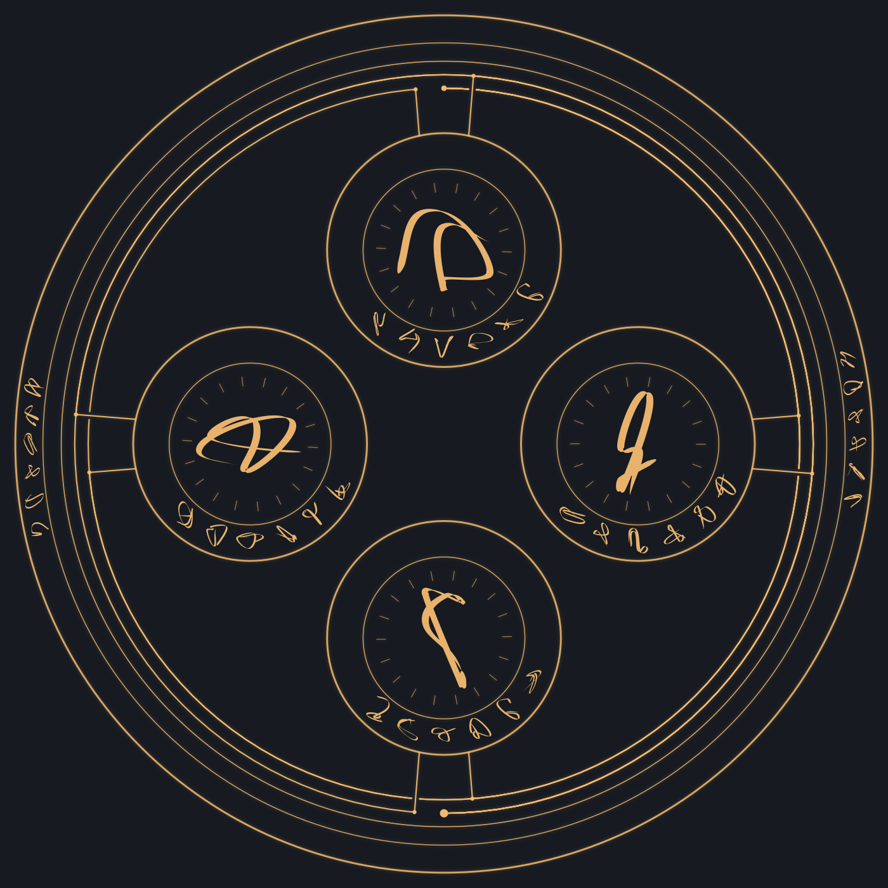
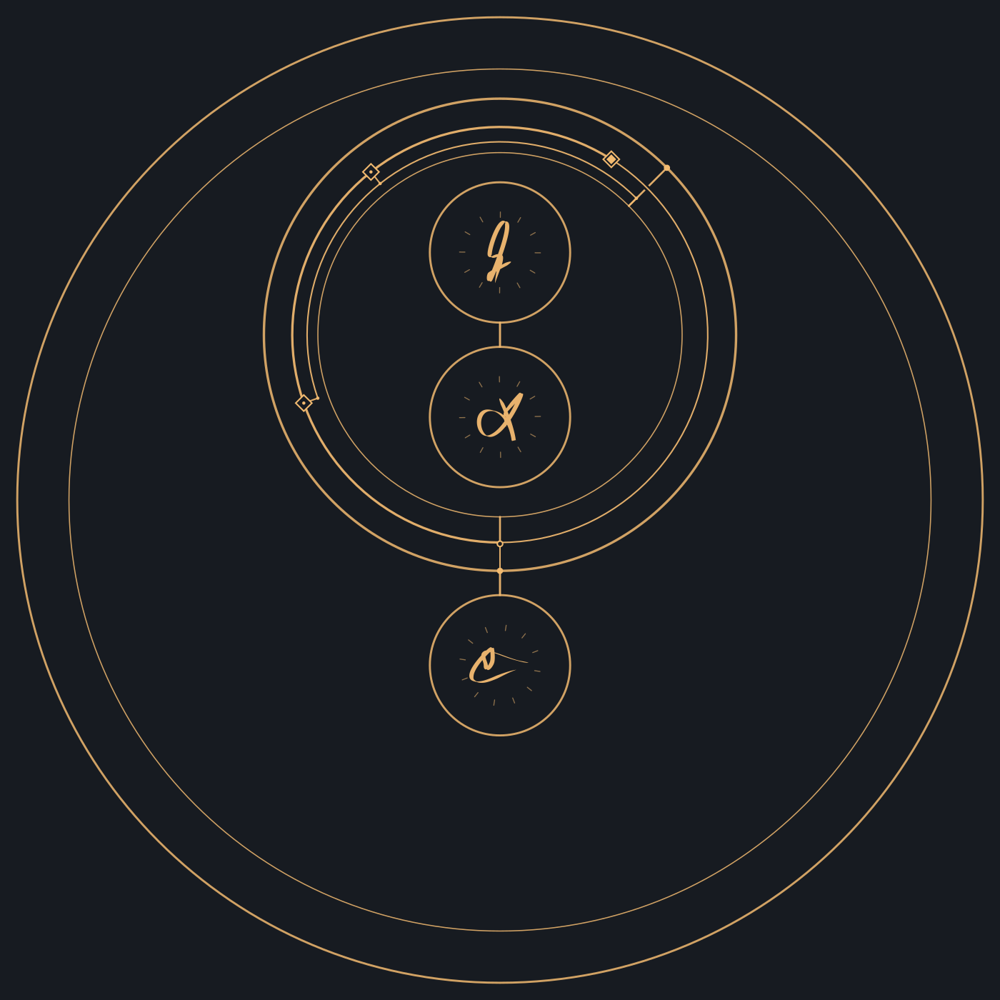
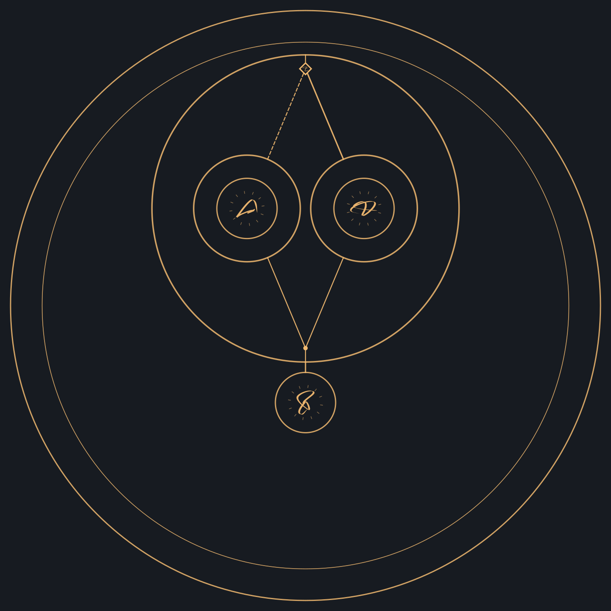

# Asterweave · 编织星辰

**把魔法阵当成程序来设计，做一款美观、实用的「魔法世界 PCB 画板工具」。**

我想做的，是让法阵里的符文、子阵和连接各有职责：为什么放在这里、先做什么、哪些同时进行、何时停止，都能说得清楚；同一份描述，也能重新生成同一个结果。

目前已经有一个可以离线运行的早期原型。这个公开库用来展示成果、解释方向，也欢迎感兴趣的人一起来做。开发源码目前在私有库中维护；这里开放讨论、设计提案和展示资料的修改。



*原型实际生成的平面法阵。中心承担主要职责，外圈是整阵共用条款，子阵各有局部铭文。不是目标效果概念图。*

## 它想解决什么

写小说、做世界观或设计游戏时，我希望魔法阵不只是漂亮的背景图，还能成为一种可以研究和设计的工具。

例如，一条火焰锁链可以拆成：

```text
凝聚火焰 → 塑成锁链 → （束缚目标 + 灼烧目标）
```

`→` 表示先后，`+` 表示并行。自由词段负责描述要做的事，工作关系负责组织结构。换一种关系，应当得到相应变化的骨架和路径，而不是给同一个模板换几个标签。

再往前走，整阵可以是一段程序，子阵可以成为模块或函数；判定、选择、循环和作用范围，用几何、符文与分布来表达。更明确、有效的描述，也能承担一部分原本需要施法者临场控制的工作。

## 已经做到哪一步

| 已有原型能力 | 当前边界 |
| --- | --- |
| 自由词段生成符文，按先后、并行和作用范围组织平面子阵 | 读取明确写出的关系，尚不自动理解任意自然语言 |
| 整阵共用铭文与子阵局部条款分别编辑、保存和高亮 | 不凭词数或笔画计算增幅、节耗与意志负担 |
| 有限次数重复、嵌套与有界控制预演 | 持续维持目前等待外部解除，完整解除流程与条件循环待做 |
| 显式条件判断，只执行满足或不满足的一支 | 判断结果由外部明确提供，不自动感知目标 |
| 明暗主题、SVG／JSON 导出、版本化重建 | 通用载入、手工画板与可复用模块调用尚未完成 |

当前展示基于工程 `0.5.1`、默认构阵算法 `rune-weave-v7`，更新于 **2026-10-18**。这是设计与控制结构的原型，尚无完整的魔法物理模拟器。

## 再看两个例子

| 重复三次后退出 | 条件选择后汇合 |
| --- | --- |
|  |  |
| 每完成一轮，计数状态前进一步；末次接出口。 | 条件满足时束缚，否则解除，所选支完成后回收魔能。 |

这些图来自实际原型导出或离线结构渲染。具体输入、版本与读图说明见[成果说明](docs/gallery.md)。

## 想找什么样的协作者

不需要先懂完整代码，也不需要先定义一整个魔法体系。能带来一个具体例子、一张改图或一段实现，就可以开始。

| 方向 | 可以从这样一件小事开始 |
| --- | --- |
| 视觉、字体与交互 | 选一张示例，改善主次、留白或线路辨识，附改图与理由 |
| 规则与世界观 | 写一个有明确输入、操作与停止条件的魔法，指出现有表达哪里不够 |
| 几何布局与布线 | 用一个最小案例说明嵌套、避障或跨线问题，并提出可检查的约束 |
| 前端与工具开发 | 协助保存／载入、局部编辑、控制预演或模块接口；先讨论一个小范围任务 |
| 测试与文档 | 找出说明与实际成果不一致的地方，提供复现步骤或更易懂的读图说明 |

**[发起协作或提出建议](https://github.com/JizhiShiroppu/Asterweave-public/issues/new/choose)** · [参与方式](CONTRIBUTING.md) · [项目原则与下一步](docs/direction.md)

可以直接说：你对哪部分感兴趣、想先做什么、手上有没有相关示例。代码协作可在公开讨论明确范围后，由维护者邀请进入开发库。欢迎小范围、可独立完成的贡献；不要求长期投入，也不要求使用 AI。

## 几条重要的设计原则

- 关系决定骨架与连接；字符编码目前只用于制作字形，不用散列值猜测词义。
- 七个基础词不是封闭词表；七星投影也只是当前的符文制作方案。
- 原文、取义、关系与来源分别保存，有损字形不承担原文存档职责。
- 同一份输入、参数和版本应能复现；确定性本身不等于规则合理。
- 相交、共享和接通分别表达；先把完整平面法阵做好，再推进动效和真正立体构造。

## 关于这个公开库

这里是展示与协作入口，暂不提供完整工具下载或在线试玩。原型以本地 HTML 运行，不依赖模型服务；后续可能加入可选的自然语言前端。

展示图为本项目原型生成，未包含外部作品参考图、小说正文、人物档或私有开发历史。公开展示不等于已选定通用开源许可证；具体代码与素材的使用授权请与维护者确认。

---

**English:** Asterweave is an early prototype of a visual programming tool for magic circles, inspired by PCB design. Explicit working relationships shape the layout; versioned inputs make results reproducible. This repository shares real outputs and welcomes collaborators in visual design, rules, geometry, frontend development and testing. Development source is currently private; please start with an issue.
