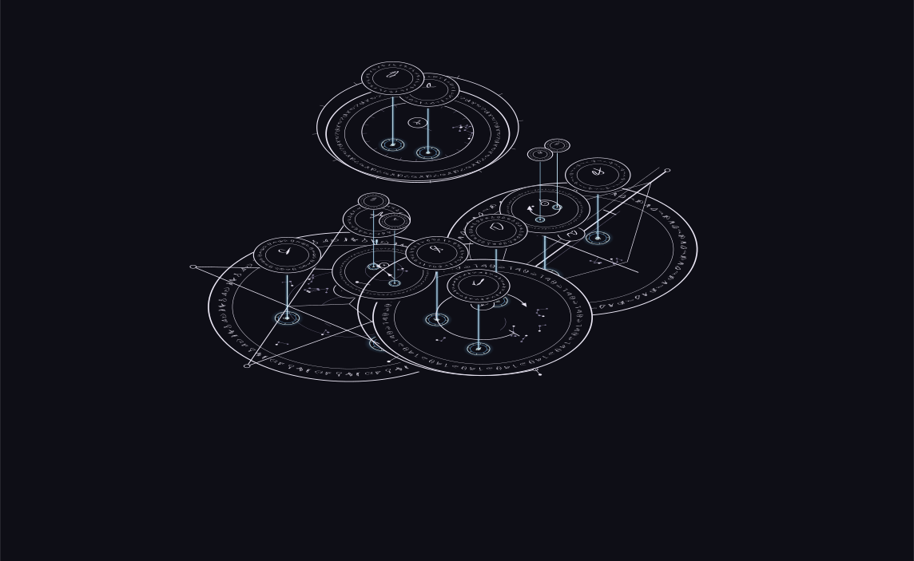

# Asterweave · 编织星辰

**一门可读、可写的法阵图形语言，以及按这门语言生成法阵的工具。**

符文写内容，几何组织结构。我希望法阵上的每个有含义的元素都能说清楚、读回来，也能在修改后继续保存和使用。

*空痕·裂：103 个阵组成的完整法术样例。斜视把层次展开，接口与柔光柱显示已有的父子归属。它们不代表新增的能量流向。*

**2026-10-22 更新** · 目前推进到统一工作台、本地软件与叠层生成：可以从结构化内容生成法阵，调整子阵的位置、大小、旋转和整体浮起，保存后继续修改。自然语言直接生成尚未接入。

[看六个当前样例](docs/gallery.md) · [一个法术怎样组织](docs/program-example.md) · [原则与路线](docs/direction.md) · [参与协作](CONTRIBUTING.md)

## 先看法阵

| 苔灯 · 18 个阵 | 契约召唤 · 47 个阵 |
| --- | --- |
|  |  |
| 从苔光成形、脚边导引到静夜维持、归途熄光。 | 观察契约与召唤内容怎样组成多层结构。 |

*潮汐归城：162 个阵。俯视看整体构图，斜视看层次；两种视角使用同一份作品。完整图见[成果图册](docs/gallery.md)。*

仓库还带有[离线展示页](index.html)：下载仓库 ZIP 并解压，双击 `index.html`，即可切换俯视／斜视、明暗主题，查看四个完整法术和两项局部试作。GitHub 文件页显示 HTML 源码；这是一份成果展示，不是生成器试玩。

## 现在可以做什么

| 当前能力 | 实际范围 |
| --- | --- |
| 结构化内容 → 法阵 | 用定义、动作、成员组织内容，生成分级画法、嵌套子阵和环形符文。现有样例已打通；不保证任意输入都能得到满意布局。 |
| 在同一工作台创作 | 内容、画布、参数、检查、撤销／重做和文件入口共用一个界面；节点编辑原型也已接入。 |
| 看清层次 | 俯视、斜视、阵内部位浮起、直属接口和柔光柱；背景星点默认关闭。 |
| 调整局部 | 选中一个子阵，拖动位置，调整大小、旋转和整体浮起；后代、接口与连接随动。顶层阵与单个部位的平面形状编辑尚未开放。 |
| 保存与继续 | SVG 导出画面，JSON 保存可继续编辑的作品；Windows 本地版已有工作目录、作品库、自动保存、备份和重启恢复。 |
| 离线使用与复现 | 已有本地软件与网页版，两端共用生成核心；同一含义、记法、参数和版本得到同一结果，旧作品按记录版本重建。 |

目前以本地软件优先、普通网站并行推进。已有 Windows x64 便携版供开发验证，**这个公开库暂不提供生成器下载或在线创作**，也不包含开发源码。

## 「能读回」做到哪里了

它是项目的验收要求，也需要分开说明验证范围：

- 既有平面生成链已完成代表性法术的 SVG 几何读回，借助词表识别词与类别。
- 本页叠层样例已核对保存的图层结构与输入一致；这不等于从独立 SVG 几何读回全部含义。
- 有损字形不能反推出任意原文；不支持任意图片识别，也不模拟真实魔法效果、耗时或能量。

公开图仅保留展示所需的绘图数据，不能当作完整作品重新载入编辑。展示图采用已保存的 `layered-4` 六例；当前工作台默认 `layered-5`，新增局部草稿编辑，旧作品保留原版本。

## 接下来一起改善什么

我们现在最需要具体的观看和创作反馈：复杂法阵哪里遮挡、文字哪里太密、子阵怎样更紧凑，以及第一次创作时哪一步不清楚。提出新记法时，需要同时说明表达什么、如何读回、哪些属性允许自由调整。

可以从一张标注图、一个最小输入或一处说明修改开始。视觉、规则、布局、交互和测试贡献都欢迎，方向与规则由维护者审核，不要求长期投入或使用 AI。

**[发起协作或提出建议](https://github.com/JizhiShiroppu/Asterweave-public/issues/new/choose)**

## 关于公开资料

这里提供项目介绍、成果图和协作入口。展示图来自本项目生成结果，不含外部参考图、小说资料、完整作品数据或私有开发历史。尚未选定通用开源许可证；使用和再分发请先与维护者确认。

**English:** Asterweave develops a readable, writable graphical language for magic circles and an offline creation tool. The current prototype generates layered circles from structured definitions, supports local subcircle adjustments, and saves editable works. This repository shares six current examples and an offline gallery, not the generator or its private source. Natural-language input and independent geometric readback of the layered SVGs remain unfinished. Contributions and concrete visual feedback are welcome through Issues.
