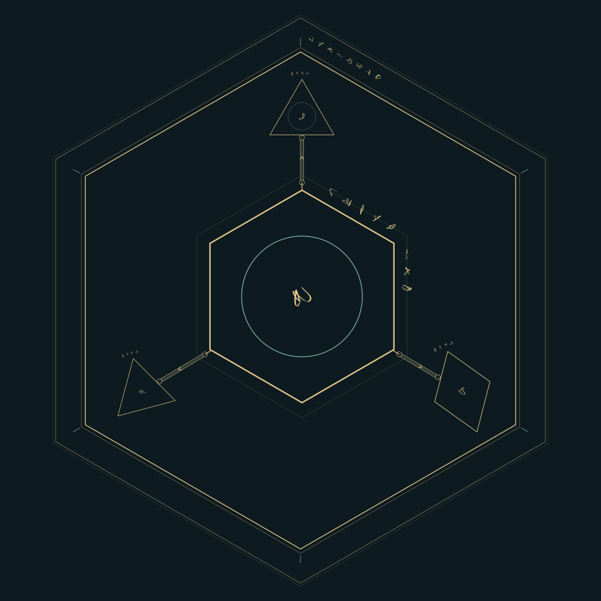
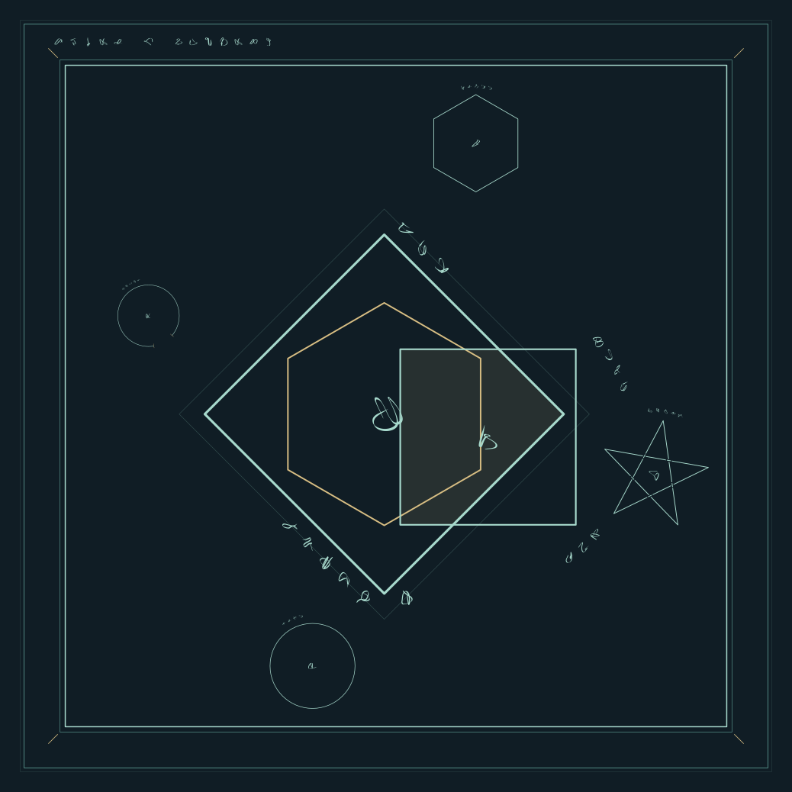
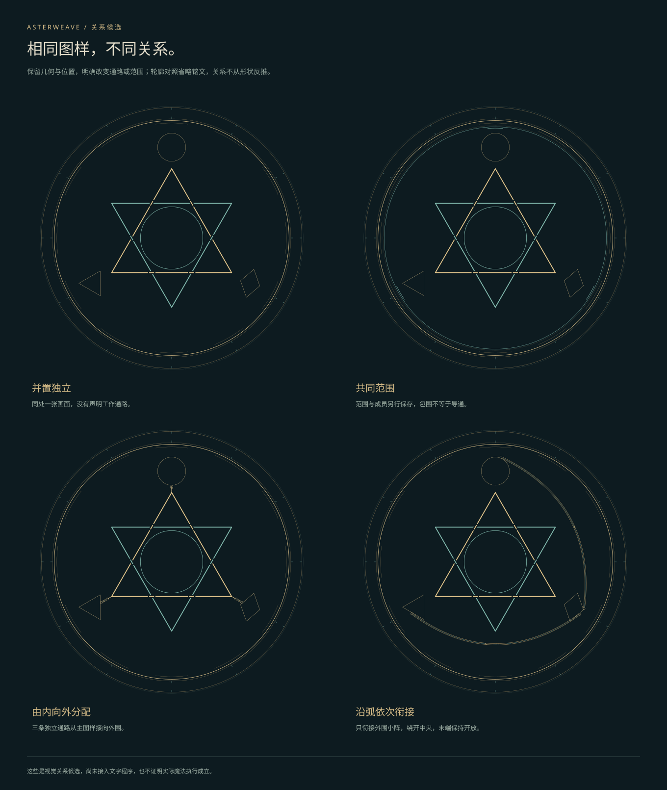
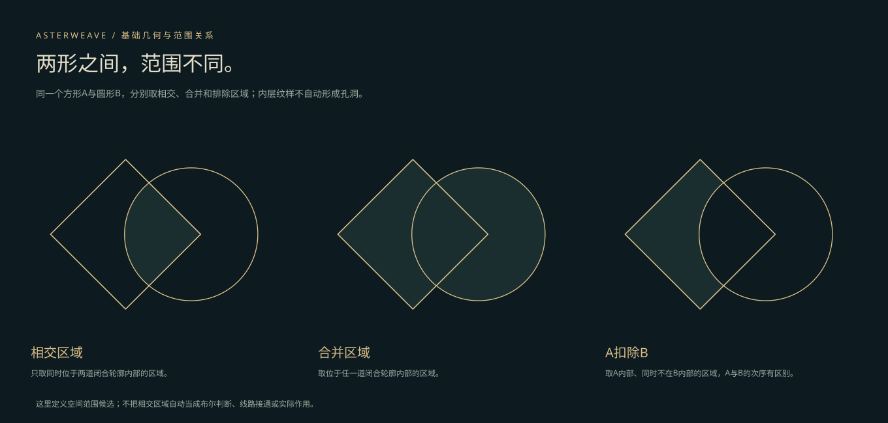

# 成果说明

以下图样及历史三图均来自 Asterweave 实际工具。展示副本去除了完整作品元数据并统一深色背景；原始检查点仍在开发库保存。本公开库不含原型源代码或可执行工具。展示更新于2026-10-19，采用已完成的工程0.26.0快照，同步开发改动未纳入。

## 三域引光：基础几何与分配



来源：`pattern-three-light-v1.svg`，图样算法 `asterweave-pattern-composition-v1`。用基础几何承载一处来源、三路去向的关系候选。原作品可以分别修改图样、原词、关系、铭文和人工覆盖；本公开副本仅用于看图，不能载入编辑。

这里的分配是明确声明的关系，不从符文笔画或图样名称推导。作品尚未绑定文字程序中的实际对象和接口，不代表已经建立魔能分配的物理机制。

## 方圆叠庭：组合、层次与留白



来源：`pattern-square-court-v1.svg`，同一图样算法。比较基础几何叠入、外框与铭文安排；图样工具支持逐形位置、角度、尺寸、锁定、撤销和SVG／JSON继续编辑。原词与关系不会因为旋转1°而改变。

## 同图不同关系



来源：`pattern-relations-v1.svg`。相同图样可声明独立、共同范围、分配、汇集或外围先后；独立关系资料决定通路及成员。交叉与导通分别记录，不能仅凭两条线相交就认为已经接通。

图样是研究候选，不是标准阵形。有限弧线布线、密集接口与长铭文仍有局限，尚不是任意路径求解器或完整字形碰撞审计。

## 两形的范围



来源：`pattern-scopes-v1.svg`。两道闭合基础轮廓可明确取相交、合并或A扣除B的范围，范围随位置与角度变化；空间范围与工作通路分别保存，内部纹样不自动成为孔洞。

几何交集不等于程序中的逻辑“与”。当前条件、互锁、计数退出、持续作用与解除的成阵机制仍待研究。复杂度按轮廓、分段、交叉、开口与基础投影分区比较，不表示强弱或能耗。

## 以下为旧画板历史样例

三张图保留各自的旧算法与输入，展示已有实验的来路；不作为新系统认可的标准阵形，也不替代上方独立的图样研究。

## 铭文分工与四支并行


来源：工程中的 `weave-v3-checkpoint-2026-10-18.svg`，构阵算法 `rune-weave-v3`，由浏览器实际导出。

四个子阵采用并行关系，中心保留各自主操作；外环承载两条整阵基底，四个子阵分别承载局部复合铭文。条款有独立的目标与来源，不为填满圆周而自动重复，也不自动叠算效果。

这是已做出的结构与排版，不表示增幅、节耗等条款已有数值模型。

## 有限次数与几何计数


输入：

```text
重复3次（凝聚火焰 → 释放火焰） → 熄灭余火
```

来源：`weave-v6-checkpoint-2026-10-18.svg`，算法 `rune-weave-v6`，离线结构渲染。

每轮完整执行凝聚与释放，随后推进一次计数。外围的分段状态链记录次数，内侧公共回返轨负责继续；到终点后退出，再熄灭余火。次数会改变状态与推进关系，不只是更换文字。

## 显式判断与分支选择


输入：

```text
若[目标仍在范围]（满足（束缚目标） + 否则（解除束缚）） → 回收魔能
```

来源：`weave-v7-checkpoint-2026-10-18.svg`，算法 `rune-weave-v7`，离线结构渲染。

判定节点连接两个候选分支，只执行选中的一支，完成后汇合。条件满足入口为实线，不满足入口为虚线。结果由外部明确提供；缺少结果时，预演在判定处等待。

选择与并行有不同关系：选择只等选中支完成，并行需要全部分支完成。此处保留v7历史画面；后续旧画板已加入线路审计，但这不表示已有完整物理执行器或任意布线能力。

## 怎样理解这些图

目前字形由词段编码生成，不能从笔画反推原文，也不能据此推断魔法效果。工作关系与字形分开保存。流向箭头是辅助读图选项，展示图默认关闭。

这些成果展示已经可复现的结构实验和可编辑的图样候选。文字程序、图样研究与旧画板尚未整合；完整物理执行、任意程序自动成阵、自然语言入口与正式创作工作台仍未完成。文字层的实际例子见[文字程序实例](program-example.md)。
