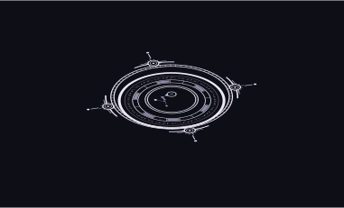
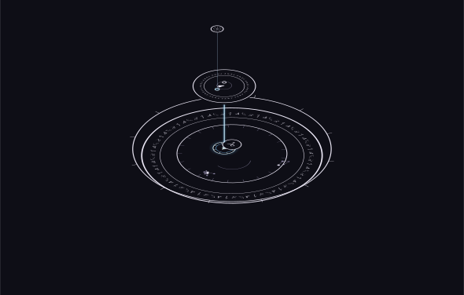

# 当前成果图册

图库保留五个展示样例：三个完整法术，两项局部试作；都来自已保存的 `layered-4` 作品。默认展示潮汐归城。当前[网页版工作室](https://jizhishiroppu.github.io/Asterweave-public/try/)采用 `layered-7`，继续按记录版本支持旧作品，并提供局部编辑、配色与动效。

[直接打开网页展示（免登录）](https://jizhishiroppu.github.io/Asterweave-public/)，可在同一页面切换明暗与俯斜视角；下载仓库后也可打开 `index.html` 离线浏览。下面的图片可直接打开查看细节。

## 潮汐归城

162 个阵，样例等级 10。先看整体，再放大查看局部；数量表示实际绘出的阵实例，不代表独立定义数或真实魔法强度。[看俯视](../assets/tidal-city-dark-flat.svg)。

## 苔灯

18 个阵，样例等级 3。内容从苔光成形、脚边导引、静夜维持到归途熄光；适合从一个较小的完整法术观察定义与嵌套。[看俯视](../assets/moss-lamp-dark-flat.svg)。

## 契约召唤

47 个阵，样例等级 5。观察多个定义在同一作品中的层次、符文带与父子接口。[看俯视](../assets/contract-dark-flat.svg)。

## 两项局部试作

| 守光环 · 单阵 | 接口与连接 · 三级 |
| --- | --- |
|  |  |
| 看符文环带、骨架和盘心的部位浮起。 | 看灯座、聚光、微光之间的直属父子关系。 |

这些是局部观察样例，不作为完整法术的分级验收。浮起高度属于布局；连接柱复写已有归属，不增加定义、执行顺序或能量流向。

## 怎样理解这些图

符文承担内容，几何组织结构，布局安排位置、大小和层次。俯视与斜视是同一作品的不同观看方式，斜视不是新的三维法术含义。背景星点默认关闭，阵内星轨保留。

五例已核对保存的图层结构与输入一致，但尚不能据此声称独立 SVG 几何读回通过。公开副本移除了完整作品元数据、内部含义属性和原始片段，密集字形路径保留六位小数以减小体积，仅供展示。可编辑作品仍需工具保存的完整 JSON。

旧图样与旧画板已从当前展示撤下，公开库提交历史可供回查。

[返回项目介绍](../README.md) · [看内容组织示例](program-example.md)
