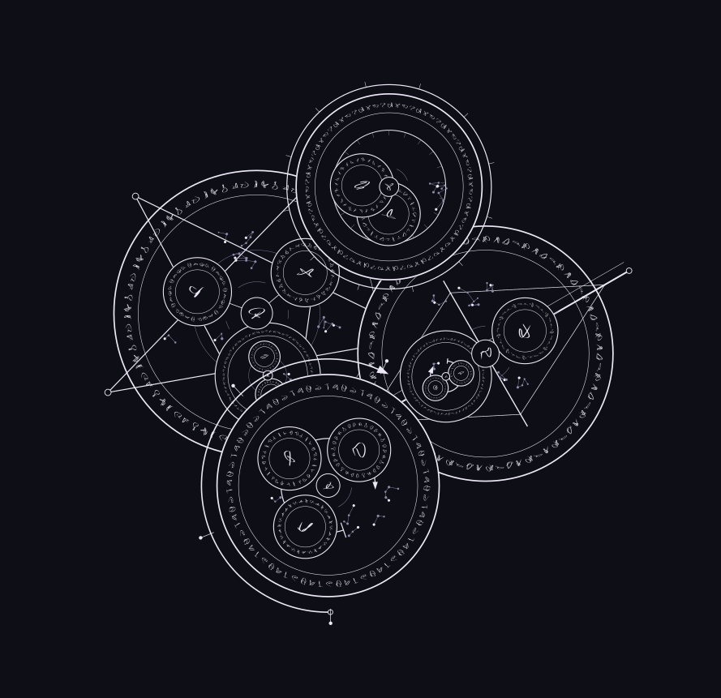

# 一个法术怎样组织：苔灯

从当前展示中的「苔灯」开始：让苔藓发出脚边的微光，沿来路导引，维持安静，最后熄灭。这里用树状说明解释实际样例，不是可直接粘贴执行的语法。[网页版工作室](https://jizhishiroppu.github.io/Asterweave-public/try/)支持结构化输入，也可用自己的 DeepSeek 临时 Key 整理魔法描述；本页记录的是原先保存的样例结构。

```text
苔灯
├─ 苔光成形〔同时〕
│  ├─ 湿石取能〔汇聚〕
│  │  ├─ 温差〔感应〕
│  │  └─ 限流〔固定〕
│  ├─ 苔叶发光〔成形〕
│  └─ 柔光滤色〔交织〕
├─ 脚边导引〔依序〕
│  ├─ 认足迹〔定位〕
│  ├─ 接续〔传递〕
│  └─ 低照〔划界〕
├─ 静夜维持〔维持〕
│  ├─ 暗度〔感应〕
│  └─ 守静〔固定〕
└─ 归途熄光〔若〕
   ├─ 数人〔判定〕
   └─ 回灭〔依序〕
      ├─ 收光〔收束〕
      └─ 还温〔归还〕
```

方括号内是动作，其余是定义名称。每个定义还携带具体文字，例如「低照」的内容是“只照 足边 不及 树洞”。树的层次表示成员归属；这份说明本身不补充新的运行规则。



## 从内容到画面

含义层记录定义与成员；记法层决定如何写成阵、语句和子阵；布局层安排位置、大小与展开；字形层生成词的形状。这样可以分别调整观看方式和字形，而不把“画得更高”解释成“魔法更强”。


当前叠层生成器会把已有父子归属显示为接口与连接柱。改变视角、层间距和部位高度，是为了观察结构。新版工作台也允许选中某个子阵，调整它的位置、大小、旋转与整体浮起，其后代及连接一起跟随。

## 保存了什么，验证了什么

完整 JSON 记录输入、版本、布局、主题与视角，供工作台继续编辑；SVG 用来导出画面。本页的公开 SVG 只保留展示数据，不是可重新载入的完整作品。

此例共有 18 个阵。保存的图层结构已与输入核对一致，独立 SVG 几何读回尚未完成。动作与文字说明法术想表达的内容，不证明真实效果可执行；也不提供魔法强度、能耗或耗时模拟。

[返回项目介绍](../README.md) · [查看全部成果](gallery.md)
